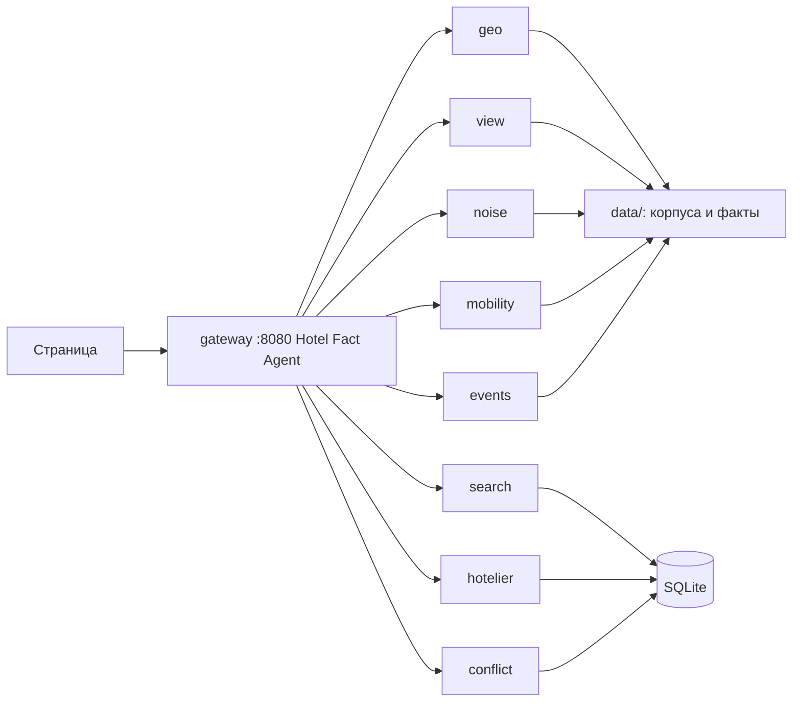

# Архитектура: Hotel Fact Agent

Концепция: `doc/concept.md`.
Постановка трека: `doc/track.md`.
Имена агентов: конвейер Room Fact Agent в `doc/Perplexity.txt` (строки 128–136). Продуктовое имя оркестратора — **Hotel Fact Agent**.
Регион прототипа: Патриаршие и Садовое кольцо, 12–15 отелей.

Снаружи один адрес: страница и API на порту 8080. Внутри Compose каждый агент — свой сервис на FastAPI. Оркестратор ходит к ним по HTTP во внутренней сети. Факты посчитаны заранее и лежат в репозитории. На защите вживую работают разбор фразы, фильтр, один пеший путь и ответ отельера.

Каркас «клиент → FastAPI → оркестратор → агенты» тот же, что у AI English Tutor. Боты, речь, Celery, векторная база и мониторинг по-прежнему не переносятся.

---

## 1. Сервисы

Наружу опубликован только шлюз. Остальные агенты без своего порта на хосте. У каждого свой `GET /health`. Шлюз собирает их в свой `/health`.

| Сервис | Роль из Perplexity | Что считает в этом прототипе |
|---|---|---|
| `gateway` | Hotel Fact Agent | Страница, публичный API, вызов агентов по рецепту YAML |
| `geo` | Geo Agent | Контур, сторона корпуса, азимут, этажность. Снимок OSM и data.mos.ru |
| `view` | View Agent | Луч по контурам соседних зданий и сектор утреннего солнца. DEM не вызываем |
| `noise` | Noise Agent | Сейчас: класс ближайшей дороги и ночной `bar` / `nightclub` / `pub` с `opening_hours` у этой стены. Не децибелы. Масштабирование того же сервиса: железная дорога, стройка, аэропорт |
| `mobility` | Mobility Agent | Минуты пешком, переход магистрали, обход закрытого выхода метро |
| `events` | City Events Agent | Сейчас: снимок закрытых выходов метро. Масштабирование того же сервиса: ГИС ОГД, афиши, перекрытия улиц |
| `hotelier` | Hotelier Agent | Один вопрос по дыре и разбор свободного текста в поля |
| `conflict` | Conflict Agent | Два значения в одной строке факта, статус `unresolved`, порог уверенности |
| `search` | Search Agent | Слоты фразы и фильтр по фактам. Взвешенный текст модели в ранг не идёт |

Компилятор снимков остаётся скриптом на машине разработчика, не сервисом в Compose. LLM-адаптер — библиотека внутри `search` и `hotelier`, не девятый контейнер.

---

## 2. Схема



Поток поиска:

1. Гость отправляет фразу и даты.
2. LLM-адаптер возвращает слоты по схеме Pydantic: якорь, ограничение по минутам, тишина, даты. Свободный текст модели в выдачу не попадает.
3. Якорь ищется в закрытом справочнике. Нет совпадения — вопрос гостю, без выдуманного адреса.
4. Hotel Fact Agent читает рецепты и запрашивает факты у geo, view, noise, mobility и events. Повторный вызов на сцене — только один пеший путь у mobility.
5. Код фильтрует отели по фактам и отдаёт две строки: что совпало, что нет, чего система не знает.

Поток отельера:

1. На экране один вопрос из рецепта с худшей уверенностью.
2. Свободный текст уходит в LLM-адаптер и возвращается полями `room_category → side` или этажностью.
3. Факт пишется рядом с расчётом OSM, конфликт не затирается.
4. Если изменилась этажность, луч видимости для этого корпуса считается снова.
5. Порядок отелей пересчитывается тем же фильтром.

---

## 3. Компоненты

### Web

Одна страница, без отдельного мобильного клиента.

- поле фразы и даты;
- карта корпусов, стороны покрашены по факту;
- две строки сравнения;
- блок «не знаем» и поле ответа отельера;
- таблица качества по `labels.json`.

Статику отдаёт тот же FastAPI. Отдельный Node-сервис в Compose не нужен. Если фронт собирается (React или обычный JS), сборка происходит внутри образа `app`.

### API

Единственная дверь снаружи.

| Метод | Путь | Назначение |
|---|---|---|
| GET | `/health` | `{"status":"ok"}` |
| POST | `/api/search` | Фраза и даты → слоты, два отеля, объяснение |
| GET | `/api/hotels/{id}` | Стороны и факты со источником |
| POST | `/api/hotels/{id}/hotelier` | Свободный текст → поля, новый порядок |
| POST | `/api/walk` | Живой пересчёт одного пути по графу из репозитория |
| GET | `/api/quality` | Метрики на размеченной десятке |

### Hotel Fact Agent

Сервис `gateway`. Он не содержит формул луча и не ветвится по имени характеристики. На характеристику он смотрит в YAML и вызывает названный сервис.

```yaml
id: facade_visibility
tools: [building_raycast]
min_confidence: 0.6
if_below: ask_hotelier
ttl_days: 90
question: "Какие категории номеров смотрят на {side}?"
```

Рецепт `pets.yaml` без гео-инструмента показывает расширяемость: поле пустое, пока отельер не ответит. Новая роль в коде для этого не создаётся.

### Инструменты

Один и тот же интерфейс у всех: вход — отель, сторона, даты, якорь; выход — факт.

| Инструмент | Когда вызывается | Результат |
|---|---|---|
| `resolve_anchor` | На каждом поиске | Точка из справочника или «уточните» |
| `walk_to` | Кэш на поиске; живой вызов по кнопке и для одного отеля на защите | Минуты, флаг магистрали, выход метро |
| `building_raycast` | При сборке снимка; повторно, если отельер сменил этажность | Перекрыто зданием OSM `{id}` с этажа N или проём |
| `facade_noise` | При сборке снимка | Оценка окружения: класс дороги и ночной POI. Не децибелы |
| `parse_hotelier` | На ответе отельера | Поля по схеме, confidence 0.95, источник `hotelier` |

Солнце — поле того же фасада, что и луч: азимут на даты попадает в сектор стороны или нет. Отдельный инструмент не заводим.

### LLM-адаптер

Библиотека внутри `app`, не отдельный шлюз. OpenAI-совместимый endpoint, имя модели и ключ из окружения. Два вызова: слоты поиска и разбор ответа отельера. Оба со structured output. Таймаут и ошибка ключа видны в логе stdout, поиск без ключа на демо-фразах может идти по заранее разобранным слотам из фикстуры.

### Хранение

SQLite в контейнере, файл в volume или в `data/`, создаётся при старте из JSON-снимков.

Таблицы по смыслу:

- отели и контуры;
- стороны (улица / двор, азимут);
- факты с источником, уверенностью, датой, конфликтом;
- ответы отельера;
- сессия текущего запроса.

Postgres допустим, если так быстрее поднять знакомый шаблон. Для 15 отелей он ничего не меняет в логике. Redis, Celery и векторный индекс не используем: очередь из одного пути не нужна, ранг считается фильтром по полям.

---

## 4. Что считается заранее

Скрипт `python -m dossier.compile` запускается на машине разработчика, когда меняются корпуса. В Compose на защите он не входит.

В git:

| Файл | Содержание |
|---|---|
| `data/hotels.geojson` | 12–15 гостиниц, data.mos.ru + контур OSM |
| `data/buildings.geojson` | Соседи в буфере корпусов |
| `data/anchors.json` | Садовая 10, Патриаршие, выходы метро |
| `data/metro_repairs.json` | Закрытые выходы, если попадают на эти станции |
| `data/walk_graph` | Граф для одного живого пересчёта |
| `data/walk_cache.json` | Минуты для остальных отелей |
| `data/facts.json` | Лучи и шум сторон |
| `data/labels.json` | Ручная проверка 10 отелей |
| `recipes/*.yaml` | Рецепты характеристик |

Сеть на старте контейнера нужна только LLM, и только если ключ задан. Overpass и data.mos на `compose up` не вызываются.

---

## 5. Конфликт источников

Сервис `conflict` записывает оба значения. Правило одно для всех рецептов:

1. Источник, который прямо утверждает поле (отельер про этаж и сторону категории), перекрывает OSM, если OSM молчит или старше.
2. Два свежих противоречия остаются в статусе `unresolved`, гостю видны оба.
3. Ниже `min_confidence` вердикт — «не знаем» и вопрос из рецепта.
4. Ответ отельера не удаляет строку расчёта.

---

## 6. Репозиторий и контейнеры

```text
gateway/          # Hotel Fact Agent, страница, публичный API :8080
geo/
view/
noise/
mobility/
events/
hotelier/
conflict/
search/
recipes/
web/
data/
docker-compose.yml
.env.example
README.md
```

У каждого агента свой Dockerfile: процесс не от root, лог в stdout, свой `/health`. В Compose наружу проброшен только `gateway` — `8080:8080`. Остальные сервисы в одной сети, `depends_on` с healthcheck. Секреты только из env. Общий каталог `data/` подключён только на чтение тем агентам, которым нужен снимок.

OSMnx стоит в образе `mobility`, потому что на сцене один раз считается путь. Остальная геометрия в образ не качается.

---

## 7. Масштабирование тех же сервисов

На защите `noise` и `events` отвечают узким снимком. Дальше источники добавляются в эти сервисы, без нового контейнера и без нового агента.

`noise`: к дороге и ночному POI добавляются железная дорога (`railway=rail`), стройка и аэропорт. Формат факта тот же: оценка окружения, источник, уверенность, дата. Децибелы и живой шумомер по-прежнему не обещаем.

`events`: к снимку ремонтов метро добавляются разрешения и перекрытия ГИС ОГД, афиши и городские события на даты поездки. Факт остаётся привязан к датам гостя.

`view`: при необходимости тот же сервис может взять DEM там, где рельеф реально закрывает обзор. В центре Москвы первый шаг — контуры зданий.

Новая характеристика без геоисточника, как «можно с собакой», по-прежнему один YAML и вопрос в `hotelier`.

## 8. Вне этого прототипа

Голос и STT, Telegram и WhatsApp, отдельные приложения iOS и Android, антибот, очередь задач, Redis, векторный поиск, Prometheus и Grafana, S3, погода, Mapillary, Сити и спальные районы.

---

## Этап 2: Масштабирование

Первый этап отвечает на запрос гостя из уже собранных снимков. Когда расчётов и обращений становится много, долгая работа уходит из запроса, а шлюз по-прежнему только принимает его и вызывает агентов.

Долгий гео-расчёт (новый луч, пересборка пешего графа, обновление снимка шума) выполняет Celery. Gateway не ждёт окончания задачи. Он ставит её в очередь и сразу отдаёт гостю уже известный факт либо статус «считается».

Та же очередь принимает всплеск запросов. Поиск и разбор ответа отельера не выполняются все сразу в процессе шлюза: лишние обращения ждут воркера. Страница и `GET /health` от этой очереди не зависят.

Prometheus снимает задержку и долю ошибок по шлюзу и по каждому агенту. По этим рядам видно, какой сервис не успевает, без отдельного разбора логов на защите.

Соцсети — отдельный слой перед Hotel Fact Agent. Бот принимает сообщение и кладёт его в ту же очередь. Ответ уходит пользователю, когда факт готов. Webhook мессенджера не вызывает geo, view или noise напрямую и не держит открытым основной запрос страницы.
